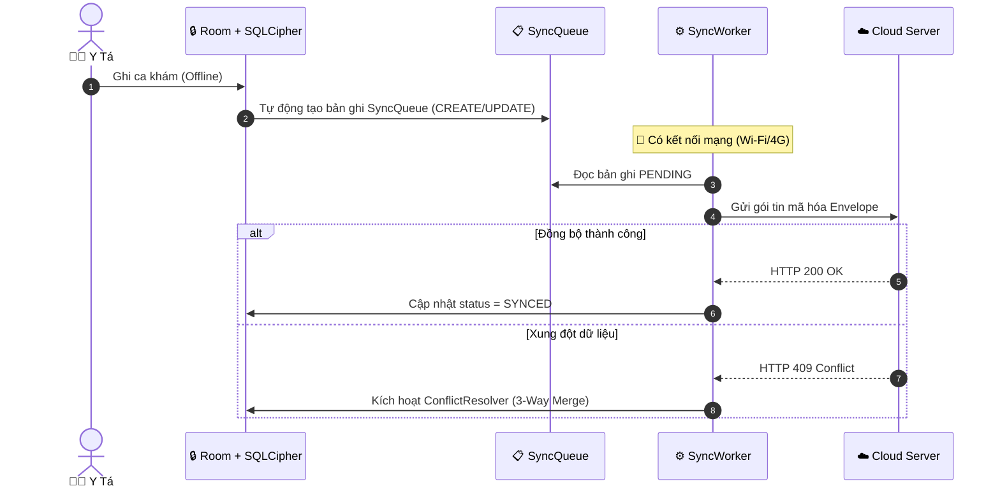

# 🩺 FieldMedic — Hệ Thống Y Tế Thôn Bản Offline-First & Kết Nối BLE

[](https://kotlinlang.org/)
[](https://developer.android.com/)
[](https://developer.android.com/jetpack/compose)
[](https://www.zetetic.net/sqlcipher/)

> **FieldMedic** là ứng dụng Android chuyên dụng cho Cán bộ Y tế Thôn bản thực hiện khám chữa bệnh, theo dõi thai kỳ và quản lý bệnh mãn tính tại các vùng sâu, vùng xa **hoàn toàn không có sóng di động hay Internet**.

---

## 📱 Giao Diện Ứng Dụng (Screenshots)

```
+---------------------------+  +---------------------------+  +---------------------------+
| 🔒 Xác Thực Sinh Trắc     |  | 🩺 Màn Hình Khám Bệnh     |  | 🔄 Trạng Thái Đồng Bộ     |
| [ Vân Tay / PIN Device ]  |  | [ Đọc Chỉ Số BLE GATT ]   |  | [ Hàng Đợi SyncQueue ]    |
+---------------------------+  +---------------------------+  +---------------------------+
```
*(Hình ảnh giao diện ứng dụng thực tế sẽ được cập nhật tại đây)*

---

## 🎯 Bài Toán Thực Tế

- **Mất sóng hoàn toàn**: Cán bộ y tế đi bản hoàn toàn không có kết nối 3G/4G hay Wi-Fi.
- **Thiết bị giá rẻ**: Chạy trên điện thoại Android phổ thông cấu hình thấp ($80 - $120).
- **Nguy cơ nhầm lẫn chỉ số**: Thao tác chép tay số liệu sinh hiệu dễ gây sai sót lâm sàng.
- **Bảo mật dữ liệu y tế**: Cần bảo vệ tuyệt đối thông tin bệnh nhân (CCCD, tiền sử bệnh) khi mất máy.

---

## ✨ Tính Năng Chính

| Tính Năng | Mô Tả Kỹ Thuật | Trạng Thái |
| :--- | :--- | :---: |
| **Lưu Trữ Offline-First** | Cơ sở dữ liệu Room cục bộ 30+ bảng, là nguồn sự thật duy nhất (Single Source of Truth) | 🟢 Hoàn thành |
| **Mã Hóa SQLCipher 256-bit** | Mã hóa toàn bộ CSDL tại thiết bị; mở khóa bằng BiometricPrompt & Android KeyStore | 🟢 Hoàn thành |
| **Đồng Bộ Tự Động & 3-Way Merge** | Hàng đợi `SyncQueue` + `SyncWorker` tự đồng bộ khi có mạng, tự xử lý xung đột dữ liệu | 🟢 Hoàn thành |
| **Khám Bệnh & Đơn Thuốc** | Ghi nhận ca khám, cảnh báo ngưỡng sinh hiệu nguy hiểm & kiểm tra tương tác dị ứng thuốc | 🟢 Hoàn thành |
| **Thu Thập Sinh Hiệu BLE** | Đọc chỉ số tự động từ máy đo huyết áp, nhiệt kế BLE qua Bluetooth GATT (IEEE 11073) | 🟡 Đang phát triển |
| **Cache Bản Đồ Thôn Bản** | Bản đồ ngoại tuyến MBTiles định vị nhà bệnh nhân qua GPS không cần mạng | 🟡 Đang phát triển |
| **Chụp & Nén Ảnh Triệu Chứng** | Chụp ảnh tổn thương ngoài da, tự động nén WebP tiết kiệm băng thông khi đồng bộ | 🟡 Đang phát triển |

---

## 🏛️ Kiến Trúc Hệ Thống

Dự án áp dụng **Clean Architecture** + **MVVM** + **Unidirectional Data Flow (UDF)**.

### 1. Sơ Đồ Kiến Trúc Tổng Quan
```
  ┌─────────────────────────────────────────────────────────┐
  │ Presentation Layer: Jetpack Compose + Material 3 + ViewModels │
  └────────────────────────────┬────────────────────────────┘
                               │ (StateFlow / AppResult)
  ┌────────────────────────────▼────────────────────────────┐
  │ Domain Layer: Pure Kotlin UseCases + Domain Models      │
  └────────────────────────────┬────────────────────────────┘
                               │
  ┌────────────────────────────▼────────────────────────────┐
  │ Data Layer: Repositories | Room + SQLCipher | Sync Engine│
  └─────────────────────────────────────────────────────────┘
```

### 2. Sơ Đồ Luồng Đồng Bộ Offline (Sync Flow)


> 📖 **Xem thêm tài liệu kỹ thuật chi tiết:**
> - [Architecture Details](docs/ARCHITECTURE.md) — Chi tiết phân tầng, BLE Pipeline, Concurrency & Mutex.
> - [Security Framework](docs/SECURITY.md) — Mã hóa SQLCipher, Android KeyStore, BiometricPrompt, PII & HIPAA.
> - [Contributing Guidelines](CONTRIBUTING.md) — Quy chuẩn lập trình Kotlin, Room rules, UI rules & Checklist.

---

## 🛠️ Công Nghệ Sử Dụng (Tech Stack)

| Công Nghệ | Phiên Bản | Phân Hệ Sử Dụng |
| :--- | :---: | :--- |
| **Kotlin** | `2.0.21` | Ngôn ngữ lập trình chính |
| **Jetpack Compose + M3** | `2024.10.01` | Giao diện người dùng khai báo (Declarative UI) |
| **Hilt (Dagger)** | `2.51.1` | Dependency Injection |
| **Room KTX + KSP** | `2.6.1` | CSDL Cục bộ ORM & SQL Transactions |
| **SQLCipher** | `4.5.4` | Mã hóa cơ sở dữ liệu 256-bit AES |
| **Android Biometric & KeyStore** | `1.4.0-alpha02` | Mở khóa sinh trắc học & quản lý khóa phần cứng TEE |
| **WorkManager KTX** | `2.10.0` | Đồng bộ dữ liệu ngầm khi có mạng |
| **Firebase Firestore & Auth** | `33.5.1` | Transport Layer đồng bộ Cloud (Tắt Persistence SDK) |

---

## 🚀 Cài Đặt & Khởi Chạy

1. **Clone repository**:
   ```bash
   git clone https://github.com/your-username/FieldMedic.git
   cd FieldMedic
   ```
2. **Cấu hình Firebase**: Đặt tệp `google-services.json` vào thư mục `app/`.
3. **Biên dịch dự án**:
   ```bash
   ./gradlew assembleDebug
   ```
4. **Chạy Unit Test**:
   ```bash
   ./gradlew testDebugUnitTest
   ```

---


---

## 📜 Giấy Phép & Đóng Góp

