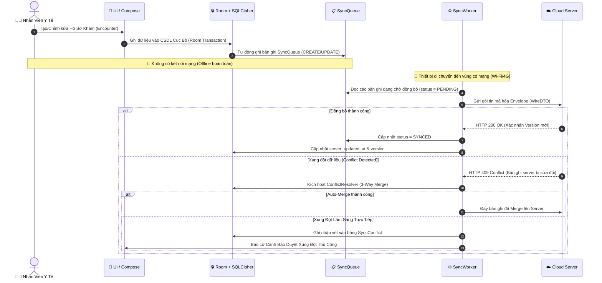
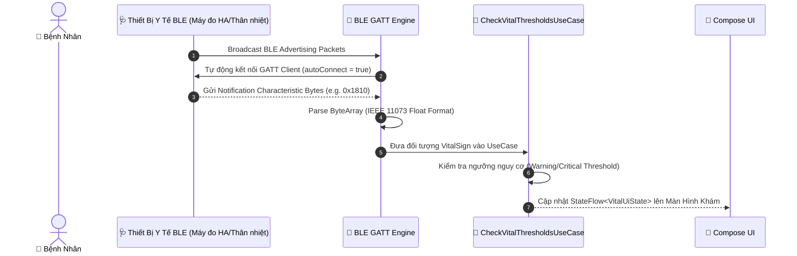

# 🏛️ FieldMedic — Kiến Trúc Hệ Thống (System Architecture)

Dài liệu này mô tả chi tiết kiến trúc phần mềm, nguyên lý thiết kế và cơ chế vận hành của ứng dụng **FieldMedic**.

---

## 1. Mẫu Kiến Trúc Tổng Quan (Clean Architecture + MVVM)

FieldMedic áp dụng nghiêm ngặt mẫu **Clean Architecture** kết hợp **MVVM (Model-View-ViewModel)** và **Luồng Dữ Liệu Một Chiều (Unidirectional Data Flow - UDF)**.

```
                  ┌─────────────────────────────────────────┐
                  │          UI Layer (Jetpack Compose)     │
                  │  Screen <── UiState ── ViewModel       │
                  └────────────────────┬────────────────────┘
                                       │
                                       ▼
                  ┌─────────────────────────────────────────┐
                  │    Domain Layer (Pure Kotlin Module)   │
                  │  UseCases | Models | AppResult/AppError │
                  └────────────────────┬────────────────────┘
                                       │
                                       ▼
                  ┌─────────────────────────────────────────┐
                  │               Data Layer                │
                  │ Repository Impl | Local (Room+SQLCipher)│
                  │ Remote Transport (Firestore) | BLE GATT │
                  └─────────────────────────────────────────┘
```

### Chi tiết các tầng:

1. **Presentation Layer (`ui/`)**:
   - Sử dụng **Jetpack Compose** kết hợp **Material 3**.
   - Mỗi màn hình tuân thủ cấu trúc:
     - `XxxUiState`: Immutable data class biểu diễn trạng thái UI.
     - `XxxUiEvent`: Sealed interface đại diện cho sự kiện từ người dùng.
     - `XxxViewModel`: Quản lý trạng thái thông qua `StateFlow` và gọi UseCase.
     - `XxxScreen`: Stateful Composable wrapper sử dụng `collectAsStateWithLifecycle()`.
     - `XxxContent`: Stateless Composable có thể xem trước qua `@Preview`.

2. **Domain Layer (`domain/`)**:
   - Tầng nghiệp vụ thuần Kotlin, không phụ thuộc vào framework Android hay UI.
   - Chứa các `UseCase` thực thi một tác vụ nghiệp vụ đơn lẻ (ví dụ: `SaveEncounterUseCase`, `CheckVitalThresholdsUseCase`).
   - Mọi UseCase trả về `AppResult<T>` đóng gói dữ liệu thành công hoặc lỗi `AppError` (Sealed Hierarchy).

3. **Data Layer (`data/`)**:
   - **Local Storage (`data/local/`)**: CSDL Room mã hóa 256-bit SQLCipher (`AppDatabase`). Là nguồn sự thật duy nhất (Single Source of Truth) cho ứng dụng.
   - **Remote Transport (`data/remote/`)**: Đóng gói giao tiếp mạng với Cloud Server (Firestore), quản lý hàng đợi đồng bộ (`SyncQueue`, `SyncWorker`).
   - **BLE Engine (`data/local/`)**: Quản lý kết nối GATT Client với các thiết bị đo sinh hiệu y tế.

---

## 2. Động Cơ Đồng Bộ Offline & Xử Lý Xung Đột (Sync Engine)

### 2.1. Hàng Đợi Đồng Bộ (`SyncQueue`)
Mọi thao tác thay đổi dữ liệu (`CREATE`, `UPDATE`, `DELETE`) trên các thực thể lâm sàng được tự động đóng gói thành bản ghi trong `SyncQueue` ngay trong cùng một SQL Transaction.

### 2.2. Thuật Toán Xử Lý Xung Đột (`ConflictResolver`)
Khi hai hoặc nhiều nhân viên y tế cùng chỉnh sửa hồ sơ một bệnh nhân lúc offline, khi có mạng `SyncWorker` sẽ đẩy dữ liệu lên server và áp dụng cơ chế 3-Way Merge:
- **No-Overlap Merge**: Nếu các thay đổi nằm trên các trường dữ liệu khác nhau, hệ thống tự động hợp nhất (Auto-merge).
- **LWW (Last-Write-Wins) / Field-Level CRDT**: Tự động giải quyết xung đột dựa trên mốc thời gian UTC (`updated_at`).
- **Clinical Conflict Escalation**: Khi phát hiện xung đột dữ liệu lâm sàng trực tiếp (mâu thuẫn liều thuốc hay chỉ số), hệ thống tạo bản ghi trong `SyncConflict` để điều dưỡng viên duyệt thủ công trên UI.



---

## 3. Luồng Thu Thập Dữ Liệu Sinh Hiệu Qua BLE

Ứng dụng kết nối trực tiếp với máy đo huyết áp, nhiệt kế hồng ngoại, máy đo SpO2 qua chuẩn **Bluetooth Low Energy (BLE) GATT**:
- Tự động quét và kết nối lại (`autoConnect = true`) với thiết bị trong `PairedDeviceDao`.
- Nhận dữ liệu qua Bluetooth GATT Notifications (Health Thermometer `0x1809`, Blood Pressure `0x1810`).
- Parse chuỗi byte thô sang định dạng số thực chuẩn y tế IEEE 11073.



---

## 4. Quản Lý Concurrency, Mutex & Async Pipeline

- **Coroutines + StateFlow/SharedFlow**: Quản lý luồng bất đồng bộ xuyên suốt từ DAO đến UI.
- **Bảo Vệ Mutex Cho Giao Dịch CSDL**:
  - Khi lưu hồ sơ khám (`SaveEncounterUseCase`), việc ghi nhận Encounter, Vitals, Đơn thuốc, Ảnh và SyncQueue thực hiện liên hoàn trong một SQL Transaction (`withTransaction`).
  - Khối `withTransaction` được bảo vệ bằng `Mutex` để đảm bảo tính **ACID**, tránh hiện tượng Race Condition khi luồng BLE và luồng nhập tay từ UI hoạt động đồng thời.
- **Xử Lý Lỗi Giao Dịch**: Khối `try-catch` được đặt **BÊN NGOÀI** `withTransaction` để khi xảy ra lỗi, Room sẽ tự động rollback toàn bộ giao dịch.

---

## 5. Tối Ưu Cho Thiết Bị Cấu Hình Thấp (Low-End Devices)

- **Target Device**: Điện thoại Android phổ thông ($80 - $120), Android 11+ (API 30+), RAM 2GB - 3GB.
- **Phân Trang Mượt Mà**: Sử dụng **Paging 3** (`room-paging`) tải danh sách bệnh nhân hàng ngàn bản ghi mà không gây giật lag hay tràn bộ nhớ.
- **Room Indexing**: Đánh chỉ mục (`@Index`) cho tất cả các cột Khóa Ngoại (Foreign Key) và các trường thường tìm kiếm (`full_name`, `national_id`, `village_id`).
- **Chạy Ngoại Luồng Màn Hình**: Tất cả thao tác IO, giải mã dữ liệu, nén ảnh WebP chạy trên `Dispatchers.IO` / `Dispatchers.Default`.

---

## 6. Cấu Trúc Thư Mục Dự Án (Project Structure)

```
com.example.fieldmedic/
├── FieldMedicApp.kt                     # Application Class
├── MainActivity.kt                      # Single Activity
│
├── data/                                # TẦNG DỮ LIỆU
│   ├── local/                           # Storage Cục bộ
│   │   ├── auth/                        # SessionManager
│   │   ├── crypto/                      # DbKeyManager, RecordCrypto, FieldCrypto
│   │   ├── dao/                         # 25+ Room DAOs
│   │   ├── db/                          # AppDatabase & DatabaseHolder
│   │   ├── entity/                      # Room Entities
│   │   ├── relation/                    # Relation POJOs & PatientListItem
│   │   ├── repository/                  # EncounterWriter, SyncEnqueuer, AuditLogger
│   │   └── view/                        # SyncSummary Database View
│   ├── remote/                          # Transport Layer
│   │   ├── auth/                        # Authenticator Transport
│   │   ├── engine/                      # PullSyncEngine, ConflictResolver
│   │   ├── transport/                   # FirestoreSyncTransport
│   │   ├── wire/                        # Wire DTOs (EncounterWire, PhotoWire)
│   │   └── worker/                      # SyncWorker (WorkManager)
│   └── repository/                      # Implementations từ Domain Repositories
│
├── di/                                  # HILT DI MODULES
│   ├── DatabaseModule.kt
│   ├── NetworkModule.kt
│   └── RepositoryModule.kt
│
├── domain/                              # TẦNG NGHIỆP VỤ LÕI
│   ├── model/                           # Domain & Error Models (AppError, AppResult)
│   ├── repository/                      # Repository Interfaces
│   └── usecase/                         # SaveEncounterUseCase, CheckVitalThresholdsUseCase...
│
├── ui/                                  # TẦNG GIAO DIỆN
│   ├── auth/                            # LockScreen & LockScreenViewModel
│   ├── sync/                            # SyncStatusViewModel
│   └── theme/                           # Colors, Extended Theme, Typography, Shapes
│
└── util/                                # Utility Helpers & Text Processors
```
