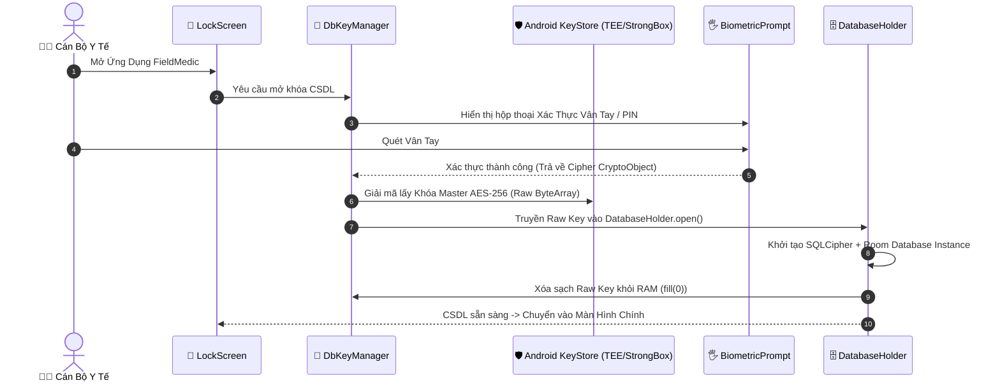

# 🔒 FieldMedic — Báo Cáo & Kiến Trúc Bảo Mật (Security Framework)

Ứng dụng **FieldMedic** tuân thủ các quy chuẩn bảo mật dữ liệu y tế nghiêm ngặt, tương đương tiêu chuẩn **HIPAA (Health Insurance Portability and Accountability Act)** và các quy định an toàn dữ liệu y tế của Việt Nam.

---

## 1. Mã Hóa CSDL Tại Thiết Bị (At-Rest Encryption)

- **SQLCipher 256-bit AES-GCM**: Toàn bộ cơ sở dữ liệu Room (`AppDatabase`) lưu tại thiết bị được mã hóa bằng SQLCipher.
- Dữ liệu ở trạng thái nghỉ (data at rest) hoàn toàn không thể đọc được nếu không có khóa giải mã master, ngay cả khi thiết bị bị root hoặc tệp `.db` bị trích xuất thủ công.

---

## 2. Quản Lý Khóa Phần Cứng & Sinh Trắc Học (Hardware KeyStore & Biometric)

Khóa giải mã CSDL không bao giờ được lưu dưới dạng văn bản rõ (plaintext). Quy trình quản lý khóa được thực hiện qua `DbKeyManager`:

1. **Khóa Master AES-256**: Được tạo ngẫu nhiên bằng `SecureRandom` và lưu mã hóa trong thư mục `noBackupFilesDir/keys/db_key.bin` (thư mục này tự động bị loại khỏi Google Drive Backup).
2. **Khóa Đóng Gói (Wrap Key)**: Được lưu trữ trong **Android KeyStore** được bảo vệ bởi vùng an toàn phần cứng **StrongBox** hoặc **TEE (Trusted Execution Environment)**.
3. **Mở Khóa Qua BiometricPrompt**:
   - Yêu cầu xác thực sinh trắc học (**BiometricPrompt**: Vân tay / Khuôn mặt) hoặc Mã PIN/Mật khẩu thiết bị (`BIOMETRIC_STRONG` hoặc `DEVICE_CREDENTIAL`).
   - Khóa giải mã chỉ được giải phóng trong RAM khi quá trình xác thực sinh trắc học trả về kết quả thành công.

---

## 3. Quản Lý Phiên Làm Việc & Vệ Sinh Bộ Nhớ RAM (RAM Hygiene)

- **Xóa Dấu Vết Khóa Trong Memory**: Khóa giải mã master chỉ tồn tại dưới dạng `ByteArray` / `CharArray` tạm thời. Ngay sau khi mở CSDL thành công, ứng dụng thực hiện `fill(0)` trên mảng byte để xóa sạch vết khóa khỏi RAM, ngăn chặn các đòn tấn công RAM Dump/Heap Analysis.
- **Tự Động Khóa Ứng Dụng (`DatabaseHolder.closeAndWipe()`)**:
  - Khi ứng dụng chuyển sang Background hoặc màn hình thiết bị bị khóa, `DatabaseHolder` sẽ đóng kết nối CSDL và xóa instance khỏi bộ nhớ.
  - Khi người dùng quay lại ứng dụng, màn hình `LockScreen` sẽ lập tức kích hoạt yêu cầu quét vân tay lại.

---

## 4. Bảo Mật Đường Truyền Mạng (In-Transit Security)

- **TLS 1.3 & Certificate Pinning**: Mọi kết nối đồng bộ giữa `SyncWorker` và Server bắt buộc qua kênh TLS 1.3 có cấu hình Certificate Pinning để chống đòn tấn công Man-In-The-Middle (MITM).
- **Mã Hóa Đóng Gói Payload (`WireDTO`)**: Dữ liệu gửi đi được mã hóa ở cấp độ DTO trước khi đẩy lên Transport Layer.

---

## 5. Bảo Vệ Quyền Riêng Tư Bệnh Nhân (PII & HIPAA Compliance)

- **Tuyệt Đối Không Log PII**: Không bao giờ ghi Họ tên, Số CCCD, Ngày sinh, Tiền sử bệnh hay Thông tin liên lạc của bệnh nhân ra `Logcat`, `Timber` hay dịch vụ báo lỗi `Crashlytics`.
- **Bảng Nhật Ký Lỗi Không Chứa PII (`error_log`)**: Bảng `error_log` trong CSDL chỉ lưu **Mã Lỗi (Error Code)** và **Tên Lớp Exception** (ví dụ: `DatabaseLockedException`), hoàn toàn không lưu chuỗi thông báo lỗi chứa tham số dữ liệu bệnh nhân.
- **Che Thông Tin Ẩn Dữ Liệu (Data Masking)**: Các trường dữ liệu nhạy cảm (Số CCCD, Địa chỉ chi tiết) được che bớt ký tự trên giao diện theo mặc định, chỉ hiển thị đầy đủ khi cán bộ y tế chạm vào nút xem chi tiết.
